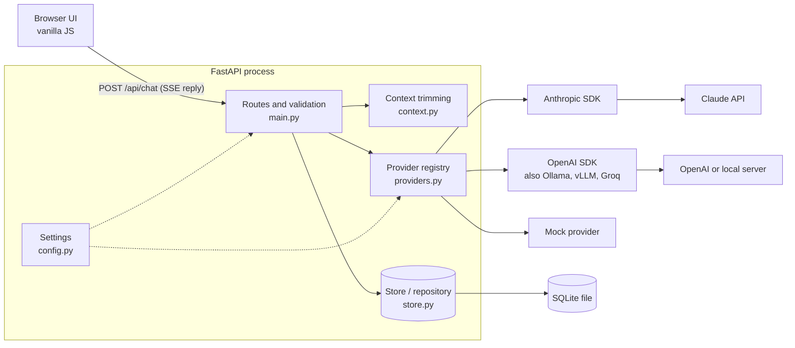
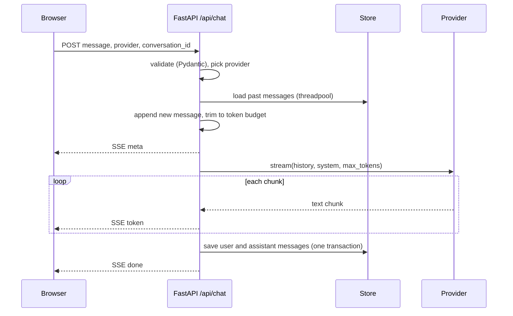
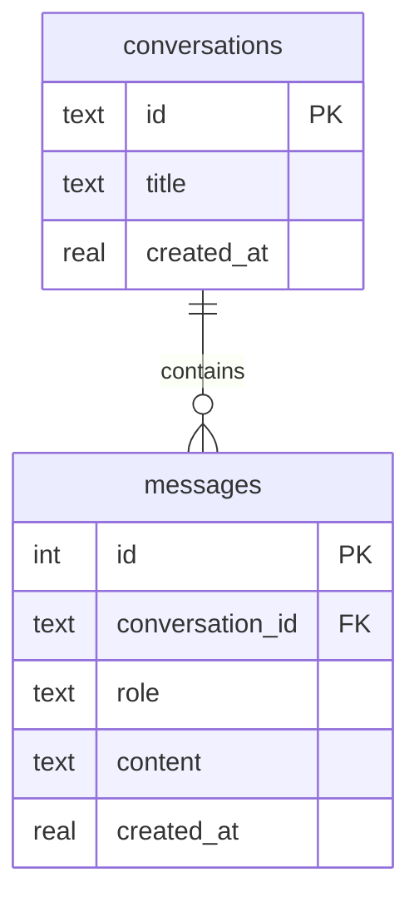

# Technical Specification

Companion to the [Functional Spec](FUNCTIONAL_SPEC.md). Each choice below states **what**, **why**, and **what else could have been used**, so each decision can be defended. Section 17 lists honest limitations.

## 1. Goals and constraints
Goals: swap LLM vendors without touching business logic; stream replies with minimal latency; stay small enough to read in an hour; be testable offline. Constraints: single developer, no paid infrastructure, runs on a laptop and in Docker.

## 2. Architecture

It is a **layered monolith**: presentation (static UI) → API layer (routing, validation, orchestration) → domain helpers (context trimming) → adapters (providers, store) → external systems. Dependencies point inward; the route handler never imports a vendor SDK.

**Why a monolith:** one deployable, one process, trivial debugging. Microservices would add network hops, deployment and tracing overhead with no scaling need here. **Alternative:** split the model gateway into its own service when several apps share it (the provider interface is already the seam).

## 3. Request lifecycle


## 4. Technology choices
| Area | Chosen | Why | Alternatives and when I'd pick them |
| --- | --- | --- | --- |
| Language | Python 3.12 | Best LLM ecosystem and SDKs; fast to iterate; type hints for clarity | **Go/Rust** for a high-throughput gateway (lower memory, real parallelism); **Java/Kotlin** in a JVM-standard company; **Node/TypeScript** for one language across UI and API |
| Web framework | FastAPI | Async-native (needed for streaming), Pydantic validation, auto OpenAPI docs, small | **Flask** (simple but sync-first, streaming needs extras); **Django** (batteries, heavier than needed); **Starlette** (FastAPI's base, fewer features); **Express/Fastify** (Node); **Spring Boot** (enterprise Java) |
| Server | Uvicorn (ASGI) | Standard for FastAPI, efficient event loop (uvloop/httptools via `[standard]`) | **Gunicorn + uvicorn workers** for multi-process production; **Hypercorn** for HTTP/2; **Granian** |
| Validation | Pydantic | Declarative constraints, clear 422 errors, same models document the API | Manual checks (error-prone); **marshmallow**; **attrs/cattrs** |
| Database | SQLite (stdlib `sqlite3`) | Zero setup, file-based, ACID, fine for one node and single-digit-GB history; no dependency | **PostgreSQL** (multi-user, concurrent writers, JSONB, pgvector for RAG) is the production path; **Redis** (very fast, but durability is weaker and relational history is awkward); **MongoDB** (document model fits messages, but no real need and weaker constraints) |
| Data access | Raw SQL behind a `Store` class | Tiny schema; explicit, fast, easy to read | **SQLAlchemy** ORM when the schema grows or Postgres arrives; **SQLModel**; **Alembic** for migrations |
| Streaming | Server-Sent Events | One-way server push over plain HTTP; same format the LLM vendors use; works through proxies; trivial to implement | **WebSockets** (bidirectional: needed for live cancel, voice, multi-user rooms; costs sticky sessions and more code); **long polling** (wasteful); **gRPC streaming** (typed and efficient but poor browser support); **fetch without streaming** (user waits for the whole reply) |
| LLM access | Official SDKs, lazy-imported | Maintained retry/auth/streaming handling; lazy import keeps them optional | **Raw httpx** (full control, more code to maintain); **LiteLLM** (one library for 100+ providers, good shortcut, hides what I wanted to show); **LangChain/LlamaIndex** (valuable for RAG/agents, heavy abstraction for plain chat) |
| Front end | Vanilla HTML/JS, no build step | ~70 lines, no toolchain, easy to read, deploys as one file | **React/Vue/Svelte** once the UI has real state (auth, settings, markdown, file upload); **HTMX** for server-driven UI |
| Config | Environment variables → frozen dataclass | 12-factor, works in Docker/CI, no files with secrets | **pydantic-settings** (validation, `.env` loading; the natural upgrade); config files; a secrets manager (Vault, AWS Secrets Manager) in production |
| Tests | pytest + FastAPI TestClient | Concise fixtures, real HTTP layer in process | unittest (verbose); Playwright for browser end-to-end tests |
| Packaging/CI | Docker, GitHub Actions | Reproducible runtime; tests on every push | Buildpacks, Podman, GitLab CI, Jenkins |

## 5. Data design

```sql
CREATE TABLE conversations (id TEXT PRIMARY KEY, title TEXT NOT NULL, created_at REAL NOT NULL);
CREATE TABLE messages (
  id INTEGER PRIMARY KEY AUTOINCREMENT,
  conversation_id TEXT NOT NULL REFERENCES conversations(id) ON DELETE CASCADE,
  role TEXT NOT NULL CHECK (role IN ('user','assistant')),
  content TEXT NOT NULL, created_at REAL NOT NULL);
CREATE INDEX idx_messages_conv ON messages(conversation_id, id);
```
- **Normalised, two tables, one-to-many.** A conversation is metadata; messages are append-only rows. Alternative: one JSON blob per conversation (simpler writes, but no per-message queries, hard to paginate or search).
- **Primary keys:** conversations use a random UUID4 (unguessable, generated in application code without a database round trip, safe to expose); messages use an auto-increment integer, which gives a total order within a conversation (`ORDER BY id`) without relying on clock resolution.
- **Index** `(conversation_id, id)` serves the hot query "all messages of one conversation in order" without a sort. Without it the query scans the table.
- **Integrity in the database, not only in code:** `CHECK` limits roles; `ON DELETE CASCADE` removes messages with their conversation. SQLite ignores foreign keys unless `PRAGMA foreign_keys=ON` is set on every connection, which `Store._conn` does.
- **Transactions:** `save_exchange` writes the conversation (if new) and both messages in one transaction, so history can never contain a user message without its reply. The context manager commits on success and closes the connection either way.
- **Connection per operation:** SQLite connections are cheap and not shareable across threads by default; opening one per call keeps the store thread-safe for the threadpool. A pool is the right answer for Postgres.
- **Not done yet:** WAL mode (allows readers during a write), migrations (Alembic), pagination of the conversation list, soft delete, encryption at rest.
- **Scaling path:** Postgres with `pgvector` covers history plus RAG embeddings in one system; add `user_id` columns and per-user indexes for multi-tenancy.

## 6. API design
REST for resources (`/api/conversations`), one RPC-style streaming endpoint (`POST /api/chat`) because a chat turn is an action, not a resource. `POST` is used because the body can be large and carries data, which is why the browser uses `fetch` and a stream reader instead of `EventSource` (which only supports GET). Failures after the 200 status are sent as an `error` event, since HTTP cannot change a status already sent. Not yet present: API versioning (`/v1`), pagination, idempotency keys, authentication.

## 7. Core algorithms
### 7.1 Streaming pipeline (async generators)
`provider.stream()` is an async generator yielding text chunks; `events()` is a second async generator that wraps each chunk into an SSE frame; `StreamingResponse` iterates it and writes each frame to the socket. Nothing buffers the whole reply, so memory stays O(1) per request apart from the accumulated text kept for saving. **Backpressure** is implicit: the server awaits each socket write, so a slow client slows consumption of the upstream stream instead of growing an unbounded queue. **Cancellation:** if the client disconnects, the generator is cancelled at the next `yield`, the upstream request is closed, and the unsaved exchange is dropped.

### 7.2 Context-window trimming (sliding window)
```
trim_history(messages, budget):
  kept = []; total = 0
  for m in messages from newest to oldest:
      t = estimate_tokens(m)              # len(text) // 4, minimum 1
      if kept is not empty and total + t > budget: stop
      kept.append(m); total += t
  reverse(kept)
  drop leading assistant messages         # APIs expect the first turn to be a user turn
  return kept
```
Complexity O(n) in messages. Invariants: the newest message is always kept, even if it alone exceeds the budget (the provider then reports the error, which is better than silently sending nothing); the result starts with a user turn. **Why this approach:** deterministic, cheap, no extra model calls. **Weaknesses:** old facts are forgotten abruptly; the estimate is approximate (about 4 characters per token for English; wrong for code and many languages) so the budget should leave headroom. **Alternatives:** exact counting with the model's tokenizer or the provider's token-count endpoint; **summarisation memory** (summarise dropped turns with a cheap model call); **retrieval memory** (embed old turns and fetch the relevant ones); **prompt caching** to cut cost of repeated prefixes.

### 7.3 Client-side SSE parsing
Bytes arrive in arbitrary chunks, so the client appends decoded text to a buffer and splits on the blank-line delimiter (`\n\n`), keeping any trailing partial frame for the next read. `TextDecoder` is used in streaming mode so multi-byte characters split across chunks decode correctly.

### 7.4 Provider selection
Name → availability check (configured keys) → lazily constructed, cached instance. Unconfigured names fail fast with 400 before any work is done.

## 8. Design patterns (where and why)
| Pattern | Where | Why / alternative |
| --- | --- | --- |
| **Strategy** | `LLMProvider` and its implementations | Interchangeable algorithms behind one interface; the route picks one at runtime. Alternative: `if vendor == ...` branches in the route (breaks Open/Closed) |
| **Adapter** | `AnthropicProvider`, `OpenAIProvider` | Translate each vendor SDK's streaming API to our single `stream()` contract |
| **Factory / registry** | `get_provider`, `create_app` | Centralise construction and configuration checks. `create_app` is the *application factory*: no work happens at import time, which makes tests and `--factory` startup clean |
| **Repository** | `Store` | Hide SQL and the database engine behind domain-level methods (`save_exchange`, `messages`); swapping SQLite for Postgres touches one class |
| **Dependency injection** | `create_app(store=...)`; tests inject a temp-file `Store` | Replace collaborators without patching globals |
| **Flyweight / cache** | `_cache` of provider instances | Reuse one SDK client (and its connection pool) per provider. Caveat: module-level mutable state; a benign race on first creation |
| **Iterator / generator** | Streaming pipeline | Lazy, composable production of chunks |
| **Fail fast / guard clauses** | Validation, provider check, 404 check | Reject bad input before doing expensive work |
| Considered later | **Decorator** for retry/timeout/logging around providers; **Circuit breaker** for repeated provider failures; **Observer/event bus** for metrics; **Chain of responsibility** for prompt-assembly steps (system prompt, RAG context, trimming) | Not needed yet; each has a clear insertion point |

## 9. SOLID principles
| Principle | How it shows up | Honest gap |
| --- | --- | --- |
| **S**ingle responsibility | `config` reads settings; `context` trims; `store` persists; `providers` talk to models; `main` orchestrates HTTP | `main.chat` still does validation, orchestration and persistence timing; a `ChatService` class would be the next extraction |
| **O**pen/closed | New provider = new class, route unchanged | `get_provider` uses an `if/elif` chain, so adding one edits the registry. A dict of factory functions or entry points would close this |
| **L**iskov substitution | Any provider can replace another: yields `str` chunks, accepts alternating messages | The contract is documented, not enforced by types or tests across real providers; a shared contract test would enforce it |
| **I**nterface segregation | `LLMProvider` has one method | Future capabilities (embeddings, token counting, tool calls) should be separate interfaces, not added to this one |
| **D**ependency inversion | `main` depends on the `LLMProvider` abstraction and an injected `Store`, not on SDKs or SQLite | `main` still calls module functions `get_provider` / `get_settings` directly; full inversion would inject a provider factory too |

## 10. OOP concepts
- **Abstraction:** `LLMProvider` (an abstract base class) states what any model backend must do, hiding how.
- **Encapsulation:** `Store` hides SQL and connection handling (`_conn` is private by convention); `Settings` is a **frozen dataclass**, so configuration cannot be mutated after creation (immutability).
- **Inheritance:** providers extend the abstract base. Used sparingly, only for a true "is-a" relationship with a shared contract.
- **Polymorphism:** the route calls `provider.stream(...)` without knowing the concrete class.
- **Composition over inheritance:** `OpenAIProvider` *has an* SDK client; the app *has a* store and a provider. This is why the OpenAI provider can serve Ollama and vLLM by changing `base_url` and `name`, with no subclass per vendor.
- **Duck typing alternative:** a `typing.Protocol` could replace the ABC (structural typing, no inheritance needed); the ABC was chosen because it fails loudly at instantiation if a method is missing.
- **Language note:** abstract async generators are awkward in Python, so the base declares a method returning `AsyncIterator[str]` and concrete classes implement `async def ... yield`.

## 11. Concurrency model
One asyncio event loop per process. I/O-bound work (waiting for the model) is `await`ed, so one process serves many concurrent streams. Blocking SQLite calls are pushed to a worker thread with `run_in_threadpool`, so they cannot stall other streams. Plain `def` routes (list, get, delete) are run in a threadpool automatically by FastAPI. The GIL is irrelevant for I/O-bound work; CPU-heavy work (e.g. local embeddings) would need processes or a separate service. To use several cores, run several worker processes; each has its own provider cache, which is fine, and SQLite serialises writers (use Postgres beyond light load).

## 12. Failure modes
| Failure | Behaviour | Improvement |
| --- | --- | --- |
| Provider not configured | 400 before streaming | none needed |
| Provider error or timeout mid-stream | `error` event, exchange not saved, details only in server logs | retries with backoff for transient errors; explicit timeouts; fallback provider |
| Client disconnects | Generation cancelled, exchange not saved | save partial replies marked incomplete |
| Prompt too large for the model | Provider error surfaces as `error` event | exact token counting; per-model limits |
| Database locked or full | Exception → 500 or `error` event | WAL mode, Postgres, alerting |
| Rate limit from the vendor (HTTP 429) | Surfaces as `error` event | queue, retry-after handling, per-user quotas |

## 13. Security
| Threat | Current mitigation | Next step |
| --- | --- | --- |
| API key leakage | Keys only from environment, `.env` git-ignored, never logged or returned | secrets manager; key rotation |
| Cross-site scripting from model output | UI sets `textContent`, never `innerHTML` for messages | If markdown rendering is added, sanitise with a vetted library |
| Abuse and cost (anyone can call the API) | Authentication, per-user chat rate limit, per-IP login limit, input length limits (phase 3, see [AUTH_SPEC](AUTH_SPEC.md)) | Daily token/spend budgets; shared (Redis) rate limiting across workers |
| Reading others' conversations or documents | Every query is scoped by `user_id`; foreign ids return 404; tests cover each endpoint | Any new endpoint must follow the same rule |
| Prompt injection / jailbreaks | Limited blast radius today: the model has no tools or private data | essential once RAG or tools exist: treat retrieved text as untrusted, least-privilege tools, output filtering, human confirmation for actions |
| Sensitive data sent to third parties | Operator's choice of provider; Ollama keeps data local | redaction, data-processing agreements, retention policy |
| SSRF via `OPENAI_BASE_URL` | Operator-controlled, not user-controlled | keep it that way |
| Dependency risk | Few, well-known dependencies | pinned versions, `pip-audit` in CI |

## 14. Testing strategy
Pyramid: unit tests for pure logic (`trim_history`); API-level tests through `TestClient` with the **mock provider** and a temp-file database (fast, deterministic, no network); a failure-injection test with a deliberately broken provider; no real-model calls in CI (non-deterministic, cost money). Gaps: contract tests against real providers (run manually or nightly with keys), browser end-to-end tests, load tests, tests for config and health. For LLM quality (phase 2) add an offline **evaluation set** with scored answers.

## 15. Deployment and operations
Docker image from `python:3.12-slim`, started with `uvicorn --factory`; database on a mounted volume (`/data`); secrets via environment; GitHub Actions runs the tests on every push. Scaling path: stateless app containers behind a load balancer → Postgres instead of SQLite → Redis for rate limits and caching → a reverse proxy with response buffering disabled for SSE (`X-Accel-Buffering: no` is already sent for nginx).

## 16. Observability (planned)
Structured JSON logs with a request ID; metrics for time to first token, total latency, tokens in/out, error rate per provider; tracing across API → provider; cost dashboards; alerting on error rate and latency.

## 17. Known limitations
1. Authentication is hand-built (scrypt, server-side sessions) and has no email verification, password reset or MFA; rate limiting is in-process (per worker). A managed identity provider and Redis are the production answers. No migrations: a database from an older version is rejected.
2. Token counts are estimated (about 4 characters per token).
3. SQLite: one node, serialised writes, no migrations.
4. The whole conversation is loaded then trimmed each turn, which is O(n) in history length; a SQL `LIMIT` on recent messages would fix it.
5. No explicit timeouts or retries beyond SDK defaults.
6. Partial replies are discarded on error or disconnect.
7. No automated test against real providers; the Anthropic and OpenAI adapters are verified by reading the SDK contract, not by CI.
8. The provider registry is not fully closed to modification (see SOLID).

## 18. Roadmap (phase 2 design sketches)
- **RAG (implemented in phase 2; see [RAG_SPEC](RAG_SPEC.md) for the actual design and its limits; hybrid BM25 + vector retrieval with rank fusion was added as phase 2b):** ingest documents → split into overlapping chunks (e.g. a few hundred tokens) → embed → store in a vector index (pgvector, Chroma or FAISS) → at query time embed the question, retrieve top-k chunks (optionally re-rank) → insert them into the prompt with source labels → answer with citations. Needs an evaluation set for retrieval quality.
- **Tools / agents (implemented in phase 4; see [TOOLS_SPEC](TOOLS_SPEC.md)):** a tool registry with JSON-schema arguments, model-chosen calls, server-side execution with allow-lists and timeouts.
- **Auth and limits:** OIDC login, `user_id` on conversations, token-bucket rate limiting in Redis.
- **Reliability:** provider decorator with retry, timeout, circuit breaker and fallback model.
- **Cost and quality:** token accounting, prompt caching, summarisation memory, evaluation harness.

## 19. Decision log
| # | Decision | Reason | Revisit when |
| --- | --- | --- | --- |
| 1 | Provider interface with one method | Smallest useful seam | Embeddings or tool calling are needed |
| 2 | SSE over WebSockets | One-way stream matches the problem, simpler infrastructure | Live cancel, voice or multi-user rooms |
| 3 | SQLite | Zero ops for a single node | Multiple users or instances |
| 4 | Official SDKs, not LangChain | Little abstraction needed for plain chat | RAG and agents arrive |
| 5 | Save exchanges atomically after a full reply | History is never half-written | Partial-reply saving is required |
| 6 | Approximate token counting | No tokenizer dependency | Budgets are tight or models differ widely |
| 7 | Vanilla JS front end | No toolchain for 70 lines | UI complexity grows |
