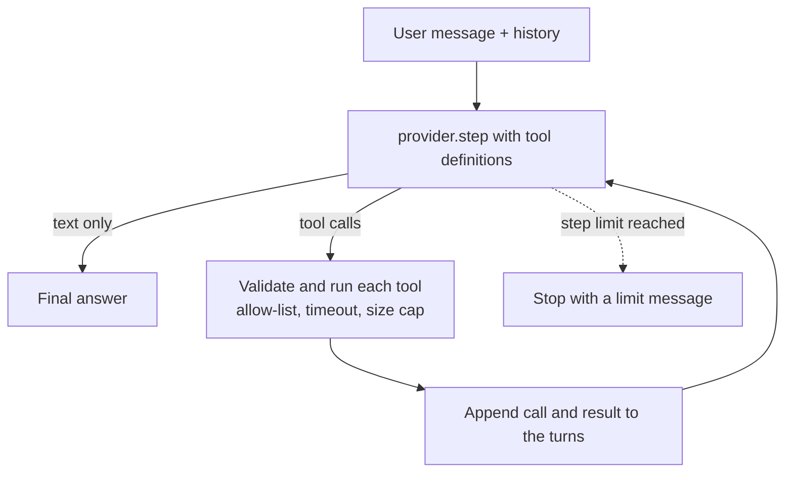

# Phase 4b Specification: Tool (Function) Calling

> Written before the code. Section 9 links each requirement to its implementation and tests.

## 1. Problem and goal
A plain chat model can only produce text. With **tool calling** the model can ask the server to run a function (calculate, look something up, search the user's documents) and then use the result in its answer. Goal: a provider-independent, safe, bounded tool loop with a small set of built-in tools.

## 2. Requirements
| ID | Requirement | Acceptance criteria |
| --- | --- | --- |
| T-1 | Opt-in | `use_tools: true` on `/api/chat` enables the loop; otherwise behaviour is unchanged |
| T-2 | Provider independence | The same loop works with Claude, OpenAI-compatible models and the mock provider |
| T-3 | Built-in tools | `calculator`, `get_current_time`, `search_documents` |
| T-4 | Allow-list | Only registered tools can run; unknown names return an error result to the model |
| T-5 | Argument validation | Missing, unknown or wrongly typed arguments are rejected before the tool runs |
| T-6 | Bounded loop | At most `TOOL_MAX_STEPS` tool rounds (default 4) and 4 calls per round; then the loop stops with a clear message |
| T-7 | Timeouts and output caps | Each call is limited to `TOOL_TIMEOUT_SECONDS` (default 5) and 2000 characters of output |
| T-8 | Errors go to the model | A failing tool returns `error: ...` as its result so the model can recover; the request does not crash |
| T-9 | Server-side identity | Tools receive the user id and knowledge base from the authenticated session, never from model-supplied arguments |
| T-10 | Visible trace | The stream carries `tool_call` and `tool_result` events; the UI shows them |
| T-11 | Clean history | Only the user message and the final answer are saved |

## 3. Design

**Neutral turn format.** Internally a conversation is a list of `user`, `assistant` (optionally with `tool_calls`) and `tool` (result) turns. Each provider adapter converts these to its vendor format (Claude `tool_use`/`tool_result` content blocks; OpenAI `tool_calls` and `role: tool` messages). The loop never sees vendor shapes: Adapter and Strategy patterns again.

**Capability interface.** Tool use is a separate abstract class `ToolUser` with one method `step(turns, system, tools, max_tokens)`. Providers that cannot call tools simply do not implement it, and the route answers 400. This is **interface segregation**: the streaming interface was not widened.

**Streaming trade-off.** Tool rounds are non-streaming (the server needs the complete tool request before acting). The final answer is then sent in small `token` chunks. Streaming tool-call deltas is possible but adds a lot of complexity; documented as a limitation.

**Registry and validation.** A dictionary of `Tool(name, description, JSON schema, function)`. A small validator checks required keys, unknown keys and string types (full JSON Schema libraries are an alternative once schemas grow). Execution runs the function in a worker thread under `asyncio.wait_for`; Python cannot kill a running thread, so the timeout frees the request, not the thread (a process or container sandbox is the robust answer).

**Identity and the confused deputy.** `search_documents` needs to know whose documents to search. That comes from `ToolContext` built from the session, so a model (or an injected instruction) cannot ask for another user's data by passing a different id. The model proposes; the server decides and enforces.

**Cost amplification.** One chat request can trigger up to `TOOL_MAX_STEPS + 1` model calls. The rate limit counts requests, not model calls, so the step cap is the cost control.

## 4. Built-in tools
- `calculator(expression)`: arithmetic parsed with Python's `ast` and evaluated by a whitelist of operators (+ - * / // % ** and unary minus). Never `eval`. Guards: 200-character limit, exponent and result-size limits so `9**9**9` cannot hang the server.
- `get_current_time(timezone)`: ISO time in an IANA zone (default UTC).
- `search_documents(query)`: runs the same retrieval as RAG over the caller's documents and returns numbered excerpts: the model decides *when* to retrieve (agentic RAG).

## 5. Alternatives
**Frameworks** (LangChain/LangGraph agents, LlamaIndex agents): faster to build complex agents, heavier abstraction. **Hosted agent APIs** (OpenAI Responses/Assistants, Anthropic server tools) run built-in tools for you. **Model Context Protocol (MCP):** an open standard for exposing tools from separate servers; a natural next step so tools live outside this app. **ReAct-style prompting** (the model writes "Action: ..." text that code parses): works with models lacking native function calling but is brittle. **Structured outputs / JSON mode:** for extracting data rather than acting. **Code execution sandboxes:** powerful and risky; needs strong isolation.

## 6. Threats
| Threat | Mitigation | Residual risk |
| --- | --- | --- |
| Model asks for an unregistered or dangerous action | Allow-list; no shell, file or network tools exist | Every new tool widens the attack surface and needs review |
| Prompt injection via documents or tool output steering later calls | Tools are read-only and low-impact; identity comes from the session; step cap | Damaging tools (send email, write data) would need human confirmation and per-tool permissions |
| Resource exhaustion (huge numbers, slow tools) | Input, exponent and result limits; timeout; output cap | Timed-out threads keep running |
| Infinite loops and runaway cost | Step and per-step call limits | Requests still cost up to N+1 model calls |
| Data leakage through tool results | Per-user scoping; output capped | Results are sent to the model provider |
| Malformed arguments from the model | Validation before execution; errors returned as results | None significant |

## 7. API
`POST /api/chat` gains `use_tools: bool = false`. New events between `sources` and `token`: `tool_call {id, name, arguments}` and `tool_result {id, name, output}`. 400 if the chosen provider cannot use tools.
Mock provider shortcuts for demos and tests: a message starting `calc:` calls the calculator, `docs:` searches documents, `time` asks for the time.

## 8. Limitations
Tool rounds do not stream; only three simple, read-only tools; no parallel execution; no per-tool permissions or confirmation step; thread timeouts are advisory; tool traces are not stored; schemas are validated by a minimal checker.

## 9. Traceability
| Requirement | Code | Tests |
| --- | --- | --- |
| T-1, T-10, T-11 | `main.chat`, `agent.run_tool_loop` | `test_tool_loop_through_the_api` |
| T-2 | `providers.ToolUser`, `to_anthropic`, `to_openai`, `MockProvider.step` | `test_message_conversion_for_vendors`, `test_provider_without_tools_is_400` |
| T-3 | `tools.py` | `test_calculator_*`, `test_search_documents_tool_is_user_scoped` |
| T-4, T-5, T-8 | `tools.execute`, `tools.validate` | `test_unknown_tool_and_bad_arguments`, `test_tool_error_is_returned_to_the_model` |
| T-6 | `agent.run_tool_loop` | `test_tool_loop_stops_at_step_limit` |
| T-7 | `tools.execute` | covered by the calculator limit tests; timeout not tested |
| T-9 | `tools.ToolContext` | `test_search_documents_tool_is_user_scoped` |
